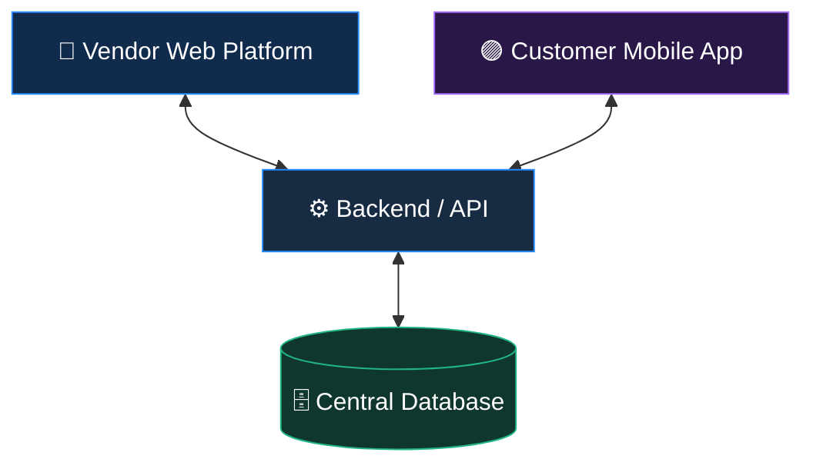

<!-- ===================== HEADER ===================== -->

<p align="center">
  
</p>

<h1 align="center">🛒 STOCK & FRESH</h1>

<h3 align="center"> Ecosistema Digital para el Mercado San Juan de Aragón</h3>

<p align="center">
  <strong>Programamos hoy las soluciones de mañana.</strong>
</p>

<p align="center">
  Página web para los locatarios del mercado y una aplicación móvil para los clientes,
  creadas para administrar las compras y ventas dentro del mercado
</p>

<p align="center">
  
  
  
</p>

---

<!-- ===================== TEAM ===================== -->

# 👥 Equipo de Desarrollo 

STOCK & FRESH es desarrollado por la empresa de Catalyst Networkers, la cual está conformada por:

<table align="center">
<tr>
<td align="center">👤<br><strong>Miembro 01</strong><br>Chávez Sánchez Ariadna</td>
<td align="center">👤<br><strong>Miembro 02</strong><br>Cruz Contreras Yaretzi</td>
<td align="center">👤<br><strong>Miembro 03</strong><br>Escamilla Serrano Gabriel</td>
<td align="center">👤<br><strong>Miembro 04</strong><br>Pérez Hernández Itzel Guadalupe</td>
</tr>
</table>

---


<!-- ===================== TABLE OF CONTENTS ===================== -->

# 📑 Table of Contents

| Section | Section | 
|:---|:---|
| [🌐 About the Project](#-about-the-project) | [⚠️ Problem Statement](#-problem-statement) |
| [🎯 Objectives](#-project-objectives) | [🧩 System Overview](#-system-overview) |
| [⭐ Core Features](#-core-features) | [🏗️ Architecture](#️-system-architecture) |
| [💻 Technologies](#-technologies) | [📁 Project Structure](#-project-structure) |
| [🚀 Roadmap](#-development-roadmap) | [📸 Screenshots](#-screenshots) |
| [👥 Team](#-development-team) | | 

---

<!-- ===================== ABOUT ===================== -->

# 🌐 About the Project

**STOCK & FRESH** is an integrated digital ecosystem designed to modernize local commerce by connecting business management tools with customer-oriented services.

The project consists of two interconnected applications:

<table>
<tr>
<td width="50%" align="center">

<h3>🔵 Vendor Management Platform</h3>

A web-based application designed to help local business owners manage their daily operations.

**Main purpose:**

Improve business organization through sales tracking, inventory management, expense records and analytics.

</td>
<td width="50%" align="center">

<h3>🟣 Customer Mobile Application</h3>

A mobile application designed to help customers organize their shopping activities and household products.

**Main purpose:**

Facilitate purchase tracking, personal grocery inventory management and product consumption monitoring.

</td>
</tr>
</table>

---

<!-- ===================== PROBLEM ===================== -->

# ⚠️ Problem Statement

Small local businesses often rely on manual processes or disconnected tools to manage their daily operations.

This creates challenges such as:

- Difficulty tracking daily sales and expenses.
- Lack of organized inventory records.
- Limited access to business statistics.
- Difficulty monitoring credit sales (fiado).
- Inefficient organization of household purchases and groceries.

**STOCK & FRESH** proposes an integrated technological solution to address these challenges and improve everyday commerce.

---

<!-- ===================== OBJECTIVES ===================== -->

# 🎯 Project Objectives

- Digitalize and simplify local business operations.
- Improve inventory control and sales tracking.
- Provide useful business statistics and reports.
- Help customers organize their grocery purchases.
- Facilitate household inventory management.
- Connect vendors and customers through technology.

---

<!-- ===================== SYSTEM OVERVIEW ===================== -->

# 🧩 System Overview

## 🔵 01. Vendor Management Platform

A web application focused on helping local vendors manage their businesses efficiently.

### Main Features

| Feature | Description |
|:---|:---|
| 📊 Sales Management | Register and monitor daily sales. |
| 📦 Inventory Management | Manage products, quantities and stock. |
| 💰 Expense Tracking | Record daily expenses and purchases. |
| 🧾 Financial Records | Monitor income and credit sales (fiado). |
| 📈 Business Analytics | Visualize sales statistics and reports. |
| 📅 Workday Management | Organize daily work activities. |

<br>

## 🟣 02. Customer Mobile Application

A mobile application focused on helping customers organize their purchases and household inventory.

### Main Features

| Feature | Description |
|:---|:---|
| 🛒 Purchase History | Review previous purchases. |
| 🏠 Personal Inventory | Register products available at home. |
| 📉 Consumption Tracking | Monitor product usage. |
| 🔔 Restocking Organization | Identify products that need replenishment. |
| 📦 Product Management | Track quantities and storage information. |

---

<!-- ===================== CORE FEATURES ===================== -->

# ⭐ Core Features

<table>
<tr>
<th width="50%" align="center">🔵 VENDORS</th>
<th width="50%" align="center">🟣 CUSTOMERS</th>
</tr>
<tr>
<td>

- Daily sales tracking
- Inventory control
- Expense registration
- Financial records
- Credit sales management
- Business analytics
- Workday organization

</td>
<td>

- Purchase history
- Personal grocery inventory
- Product consumption
- Restocking organization
- Product quantity tracking
- Storage information

</td>
</tr>
</table>

---

<!-- ===================== ARCHITECTURE ===================== -->

# 🏗️ System Architecture

The proposed system architecture connects both applications through a centralized backend and database.



### Main Components

| Component | Responsibility |
|:---|:---|
| Frontend | User interfaces for vendors and customers. |
| Backend | Business logic and data processing. |
| Database | Centralized information storage. |
| API | Communication between applications and backend. |

*Architecture subject to updates during development.*

---

<!-- ===================== TECHNOLOGIES ===================== -->

# 💻 Technologies

The technologies below will be updated once the development team finalizes the technology stack.

<p align="center">
  
</p>

| Category | Technology |
|:---|:---|
| Web Frontend | To be determined |
| Mobile Development | To be determined |
| Backend | To be determined |
| Database | To be determined |
| Version Control | Git & GitHub |

---

<!-- ===================== PROJECT STRUCTURE ===================== -->

# 📁 Project Structure

```text
STOCK-AND-FRESH/
│
├── documentation/
│   ├── diagrams/
│   └── requirements/
│
├── vendor-platform/
│   ├── frontend/
│   └── backend/
│
├── customer-app/
│
├── database/
│
├── images/
│
├── screenshots/
│
└── README.md
```

*Illustrative structure. Actual folders will be documented as the project develops.*

---

<!-- ===================== ROADMAP ===================== -->

# 🚀 Development Roadmap

| Phase | Description | Status |
|:---|:---|:---:|
| 01 | Requirements Analysis | 🔄 |
| 02 | System Architecture | ⏳ |
| 03 | Database Design | ⏳ |
| 04 | Vendor Platform | ⏳ |
| 05 | Customer Application | ⏳ |
| 06 | Backend Integration | ⏳ |
| 07 | Testing & Validation | ⏳ |
| 08 | Final Deployment | ⏳ |

**Legend:**
- 🔄 In Progress
- ⏳ Pending
- ✅ Completed

---

<!-- ===================== SCREENSHOTS ===================== -->

# 📸 Screenshots

Visual demonstrations of STOCK & FRESH will be published here as development progresses.

<table>
<tr>
<th align="center">Vendor Management Platform</th>
<th align="center">Customer Mobile Application</th>
</tr>
<tr>
<td align="center">

**Coming Soon**

</td>
<td align="center">

**Coming Soon**

</td>
</tr>
</table>

---


<p align="center">
  <strong>STOCK & FRESH</strong>
</p>

<p align="center">
  <i>Building a smarter, more connected local commerce community.</i>
</p>

<p align="center">
  <sub>Developed with 💙 by the STOCK & FRESH team · 2026</sub>
</p>
